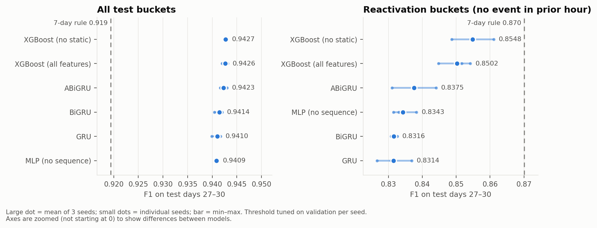
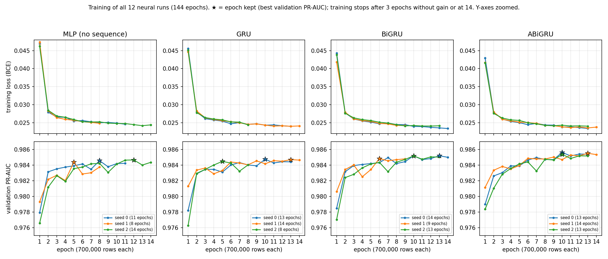

# Serverless Cold-Start Prediction

Forecasting **cold starts** of serverless (FaaS) functions on the public **Huawei Cloud trace 2025, Region 5**, with rule baselines, XGBoost and neural sequence models (MLP, GRU, BiGRU, ABiGRU).

> **Task.** For each function and each 5-minute time bucket, predict whether the function will have at least one cold start in that bucket, using only information from earlier buckets.

Full technical documentation, including data, features, models, results and design decisions: **[docs/PROJECT_DOCUMENTATION.md](docs/PROJECT_DOCUMENTATION.md)**.

## Results (test days 27–30, 3-seed means)

| Model | F1 | MCC | PR-AUC |
|---|---|---|---|
| XGBoost (no static features) | 0.9427 ± 0.0002 | 0.9341 | 0.9881 |
| XGBoost (all 57 features) | 0.9426 ± 0.0005 | 0.9340 | 0.9877 |
| ABiGRU | 0.9423 ± 0.0006 | 0.9337 | 0.9884 |
| BiGRU | 0.9414 ± 0.0007 | 0.9326 | 0.9880 |
| GRU | 0.9410 ± 0.0008 | 0.9322 | 0.9874 |
| MLP (no sequence) | 0.9409 ± 0.0003 | 0.9320 | 0.9871 |
| Rule: event in this slot on ≥ 4 of the last 7 days | 0.9194 | 0.9074 | 0.8564 |

* Learned models beat the best rule by about 0.022 F1. XGBoost and ABiGRU are tied.
* Most of the signal is daily and weekly repetition; the sequence encoders add very little.
* Brand-new functions with no history are **not** predictable from hardware and pool context (F1 0.24).

Details, slices and confidence intervals: `v2/results/benchmark.md`, `v2/results/multiseed_summary.md`.



More figures in [`v2/figures/`](v2/figures): precision–recall and ROC curves, confusion matrices, feature importance, training curves, pre-warming trade-off.

## Pre-warming simulation

`v2/prewarm_sim.py` replays the test days and pre-warms one container per chosen function per 5-minute bucket:

| Policy | Containers per bucket | Cold starts avoided | Wasted pre-warms | Idle container-hours |
|---|---|---|---|---|
| Keep-alive 60 min | 119 | 68.8% | 58.9% | 6,747 |
| Rule: 7-day majority | 50 | 64.4% | 7.7% | 366 |
| XGBoost | 50 | 66.4% | 5.9% | 283 |
| ABiGRU | 52 | 67.4% | 7.1% | 350 |

Prediction-driven pre-warming gets close to a long keep-alive's benefit with about 20 times fewer idle container-hours (ceiling: 70.4%). Additional checks (calibration, paired significance tests, rolling-origin evaluation, XGBoost tuning) are summarized in the documentation, Section 8.12.

## Repository layout

```
v2/                 current pipeline
  data.py           CSVs -> cached matrices (527 functions x 8,928 buckets)
  features.py       57 leakage-safe features
  frames.py         time-based train / validation / test splits
  run_gbdt.py       rule baselines + XGBoost (trains and saves)
  run_xgb_seeds.py  extra XGBoost seeds
  nets.py           neural models (MLP, GRU, BiGRU, ABiGRU), save/load
  run_deep.py       trains one neural model: python3 v2/run_deep.py <model> <seed>
  evalx.py, report.py, final_table.py, multiseed.py, save_thresholds.py   evaluation
  predict.py        load a saved model and predict
  make_figures.py   paper figures -> figures/
  prewarm_sim.py    pre-warming simulator
  extra_eval.py, calibration.py, robustness.py   additional evaluations
  training_report.py   training evidence report + fig8
  models/           trained models (XGBoost .json, neural .pt) + thresholds.json
  results/          benchmark tables, training records (info_*.json), training_report.md, logs/
archive_v1/         earlier pipeline (smoke-tested only), kept for reference
docs/               full documentation
research/           notes on the reference paper and design
```

## Training evidence

Every training run is documented in **[`v2/results/training_report.md`](v2/results/training_report.md)**: 12 neural runs (4 models × 3 seeds, **144 epochs**), the epoch kept for each, training times, XGBoost tree counts and SHA-256 fingerprints of all saved models. The console output printed during training is in [`v2/results/logs/`](v2/results/logs), and per-epoch numbers are in `v2/results/info_*.json`. Logs, records and the histories stored inside the checkpoints are cross-checked and agree for every epoch.



Live demo (about 1 minute, writes only to the system temp folder):

```bash
COLDSTART_SMOKE=1 python3 v2/run_deep.py abigru 0
```

## Setup

```bash
python3 -m venv .venv && source .venv/bin/activate     # Python 3.8
pip install -r requirements.txt
```

## Data (not included in this repository)

1. Download **"Region 5 cold starts"** from the Huawei data release: <https://github.com/sir-lab/data-release> (see `README_data_release_2025.md` there).
2. Unzip so the files are at `dataset/raw/region5_cold_starts/R5/day_00.csv … day_30.csv` (31 files, 805,745 rows).
3. Build the cache:

```bash
python3 v2/data.py
```

## Use the trained models (no training needed)

```bash
python3 v2/predict.py --list                                    # saved models
python3 v2/predict.py --model abigru_s0 --function 0 --day 28   # replay one function for one day
python3 v2/predict.py --model xgb_full_s42 --function "210--261--pool24-600-512" --day 28
```

The day must be at least 7, because 7 days of history are needed. Thresholds are read from `v2/models/thresholds.json`.

## Retrain and reproduce

```bash
python3 v2/run_gbdt.py                 # rules + 4 XGBoost variants (~2 min)
python3 v2/run_xgb_seeds.py            # optional extra seeds
python3 v2/run_deep.py abigru 0        # neural models; also gru, bigru, mlp_static; seeds 0 1 2
python3 v2/report.py                   # -> v2/results/benchmark.md
python3 v2/multiseed.py                # -> v2/results/multiseed_summary.md
python3 v2/save_thresholds.py          # -> v2/models/thresholds.json
python3 v2/make_figures.py             # -> v2/figures/*.png (needs matplotlib)
python3 v2/prewarm_sim.py              # -> v2/results/prewarm_sim.md, figures/fig7_prewarm_tradeoff.png
python3 v2/extra_eval.py; python3 v2/calibration.py; python3 v2/robustness.py   # additional evaluations
python3 v2/training_report.py          # -> v2/results/training_report.md, figures/fig8
```

Neural training picks the device automatically: NVIDIA GPU (CUDA), else Apple GPU (MPS), else CPU (force one with `COLDSTART_DEVICE=cpu`, `cuda` or `mps`). A BiGRU or ABiGRU run takes about 15 minutes on an Apple Silicon laptop. XGBoost results reproduce exactly; neural results reproduce exactly on the same machine and seed, and may differ slightly on other hardware.

## Reference

N. Saravana Kumar and S. Selvakumara Samy, *Cold Start Prediction and Provisioning Optimization in Serverless Computing Using Deep Learning*, Concurrency and Computation: Practice and Experience, 2025, e8392. This project adapts its ABiGRU model to the Huawei trace; it is not an exact reproduction (see the documentation, Section 4.4.4).

Data: Huawei Cloud public traces, sir-lab/data-release ("Serverless Cold Starts and Where to Find Them", EuroSys 2025).
