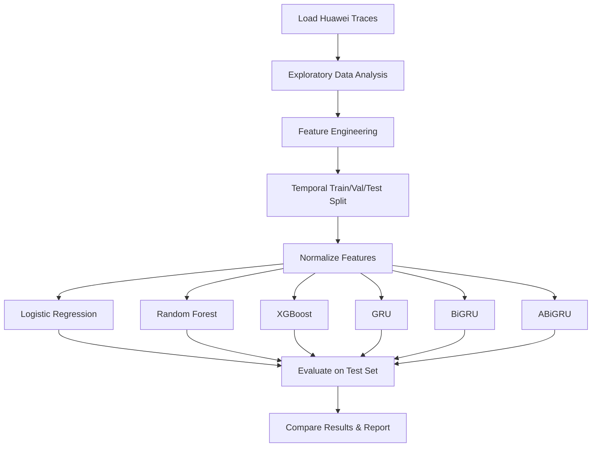

# Algorithm Selection & Experimental Design

> **Historical plan:** Sections 1–6 below predate the Region 5 cold-start CSV audit. They include speculative mappings to request/telemetry columns that are absent from the files actually used. They are preserved as project history and must not be treated as current implementation facts. The authoritative schema, task definition, bucket interval, split, and leakage controls are in [Current implementation correction](#current-implementation-correction-2026-11-12) at the end of this document.

## 1. Reusability Analysis of Original Algorithms

### What Can Be Reused

| Component | Reusable? | Adaptation Required |
|-----------|-----------|---------------------|
| GRU cell architecture | ✅ Yes | None — standard GRU gates are dataset-agnostic |
| Bidirectional wrapper | ✅ Yes | None — PyTorch `nn.GRU(bidirectional=True)` |
| Attention mechanism | ✅ Yes | Adjust input dimensions to match new hidden size |
| Max pooling layer | ✅ Yes | Adjust kernel size for new sequence lengths |
| Binary cross-entropy loss | ✅ Yes | None |
| RMSProp optimizer | ⚠️ Partially | Will use as one option; also evaluate Adam/AdamW |
| Feature engineering pipeline | ❌ No | Completely different data schema; must rebuild |
| Data preprocessing | ❌ No | Different data format (time series vs. per-invocation) |
| Train/test split strategy | ❌ No | Must use temporal split for time series data |

### What Must Be Built From Scratch

1. **Data loading pipeline** — Parquet-based loading for Huawei trace data
2. **Feature engineering** — Map new dataset fields to model features
3. **Label construction** — Derive binary cold start labels from `num_cold_starts`
4. **Sequence construction** — Sliding window over per-function time series
5. **Class imbalance handling** — Stratified sampling or class weights
6. **Temporal data splitting** — Day-based splits instead of random splits

---

## 2. Feature Mapping: Original → New Dataset

### Direct Mappings

| Original Feature | New Dataset Field(s) | Mapping Strategy |
|-----------------|---------------------|------------------|
| Invocation Frequency | `requests` (time series) | Direct: requests per minute |
| Timestamp | `day`, `time` (time series index) | Encode as minute-of-day, day-of-week |
| Latency | `totalCost` (time series) | Use average total cost per minute as latency proxy |
| Duration | `avgDuration` (time series) | Direct: average function duration per minute |
| Historical Cold Starts | `num_cold_starts` (time series) | Cumulative or windowed count from historical data |
| Event Type | Not directly available | Omit or derive from invocation patterns |
| Cold Start Indicator | `num_cold_starts > 0` (time series) | **Target variable**: binary indicator at minute t+1 |
| Consecutive Cold Starts | Derived from `num_cold_starts` | Count consecutive minutes with cold starts |
| Time Since Last Cold Start | Derived from `num_cold_starts` | Minutes since last minute with `num_cold_starts > 0` |

### Additional Features from New Dataset

| New Feature | Source Field | Description |
|-------------|-------------|-------------|
| Pod count | `num_pods` | Number of active pods (warm containers) |
| Scaling events (up) | `num_scale_up` | Number of scale-up events in the minute |
| Scaling events (down) | `num_scale_down` | Number of scale-down events in the minute |
| CPU utilization | `avgCPU` | Average CPU usage across pods |
| Memory utilization | `avgMemory` | Average memory usage across pods |
| Request rate change | Derived from `requests` | Δrequests between consecutive minutes |
| Cold start cost | `totalCost_cold_start_sum` | Total cold start cost in the minute |
| Idle minutes | Derived from `requests` | Consecutive minutes with zero requests |

---

## 3. Problem Reformulation

### Original Formulation (Paper)

> Given a single invocation record with 9 features, predict whether that invocation will experience a cold start (binary classification).

### New Formulation (This Project)

> Given a function's historical time series over the past **W minutes** (a window of multi-variate observations), predict whether the function will experience **at least one cold start in the next minute** (binary classification at the function-minute level).

### Formal Definition

**Input**: For function $f$ at time $t$, the input is a matrix:

$$X_{f,t} = [x_{f,t-W+1}, x_{f,t-W+2}, \ldots, x_{f,t}] \in \mathbb{R}^{W \times D}$$

Where:
- $W$ = lookback window size (hyperparameter, e.g., 10, 30, 60 minutes)
- $D$ = number of features per time step
- $x_{f,\tau} \in \mathbb{R}^D$ is the feature vector for function $f$ at minute $\tau$

**Target**:

$$y_{f,t+1} = \begin{cases} 1 & \text{if } \texttt{num\_cold\_starts}_{f,t+1} > 0 \\ 0 & \text{otherwise} \end{cases}$$

**Objective**: Learn a function $g: \mathbb{R}^{W \times D} \to [0, 1]$ such that:

$$\hat{y}_{f,t+1} = g(X_{f,t})$$

### Why This Reformulation Is More Practical

1. **Actionable predictions**: A platform can pre-warm containers 1 minute before predicted cold starts
2. **Leverages rich time series**: Uses temporal patterns across multiple metrics rather than point-in-time features
3. **Aligned with data granularity**: The Huawei dataset naturally provides per-minute aggregations
4. **Avoids label ambiguity**: Cold start events map cleanly to minute-level binary indicators

---

## 4. Selected Algorithms

### Algorithm Portfolio

| # | Algorithm | Category | Justification |
|---|-----------|----------|---------------|
| 1 | **Logistic Regression** | Linear baseline | Establishes minimum viable performance; interpretable; fast |
| 2 | **Random Forest** | Tree-based baseline | Captures non-linear feature interactions; no sequence modeling |
| 3 | **XGBoost** | Gradient boosting baseline | State-of-the-art tabular learning; strong regularization |
| 4 | **Standard GRU** | Recurrent (unidirectional) | Captures temporal dependencies in forward direction only |
| 5 | **Bidirectional GRU (BiGRU)** | Recurrent (bidirectional) | Captures both past and future context in the training window |
| 6 | **ABiGRU** | Proposed (from paper) | Adds attention to BiGRU; learns which time steps matter most |

### Architecture Details

#### Baselines 1–3: Classical ML

For classical ML models, the input time series window $X_{f,t} \in \mathbb{R}^{W \times D}$ is **flattened** into a single feature vector of dimension $W \times D$. Additionally, summary statistics (mean, std, min, max, last value) are computed over the window for each feature, producing a feature vector of dimension $5 \times D + W \times D$.

> [!TIP]
> For classical ML baselines, using hand-crafted summary statistics (mean, std, min, max, trend) over the lookback window often outperforms raw flattened features, as it reduces dimensionality while preserving key temporal patterns.

#### Baseline 4: Standard GRU

```
Input (W × D) → GRU(hidden=64) → Last hidden state → Dense(64) → ReLU → Dropout(0.3) → Dense(1) → Sigmoid
```

#### Baseline 5: Bidirectional GRU

```
Input (W × D) → BiGRU(hidden=64) → Last hidden states (forward + backward, dim=128) → Dense(64) → ReLU → Dropout(0.3) → Dense(1) → Sigmoid
```

#### Proposed: ABiGRU

```
Input (W × D) → BiGRU(hidden=64) → Attention(128) → MaxPool1D → Dense(64) → ReLU → Dropout(0.3) → Dense(1) → Sigmoid
```

### Hyperparameter Search Space

| Hyperparameter | Values to Explore |
|---------------|-------------------|
| Lookback window W | 5, 10, 20, 30, 60 minutes |
| Hidden units (GRU) | 32, 64, 128 |
| Number of GRU layers | 1, 2 |
| Dropout rate | 0.1, 0.2, 0.3, 0.5 |
| Learning rate | 1e-4, 5e-4, 1e-3, 5e-3 |
| Batch size | 32, 64, 128, 256 |
| Optimizer | RMSProp, Adam, AdamW |
| Class weight ratio | 1:1, 1:3, 1:5, balanced |

---

## 5. Feature Engineering Plan

### Phase 1: Raw Features (from time series)

Direct columns from the per-minute time series data:

| Feature | Column | Notes |
|---------|--------|-------|
| Request count | `requests` | Number of invocations in the minute |
| Number of pods | `num_pods` | Active container count |
| Scale-up events | `num_scale_up` | Platform scaling decisions |
| Scale-down events | `num_scale_down` | Platform scaling decisions |
| Total cost | `totalCost` | Aggregate invocation cost |
| Average duration | `avgDuration` | Mean function execution time |
| Average CPU | `avgCPU` | Mean CPU utilization |
| Average memory | `avgMemory` | Mean memory utilization |
| Number of cold starts | `num_cold_starts` | Cold starts in the minute (also used for label) |

### Phase 2: Engineered Features (derived)

| Feature | Derivation | Rationale |
|---------|-----------|-----------|
| Time since last cold start | Minutes since last `num_cold_starts > 0` | Recency of cold starts predicts future cold starts |
| Consecutive cold start minutes | Count of consecutive minutes with `num_cold_starts > 0` | Sustained cold start patterns |
| Consecutive idle minutes | Count of consecutive minutes with `requests == 0` | Idle periods precede cold starts (container eviction) |
| Request rate delta | `requests[t] - requests[t-1]` | Traffic spikes trigger scaling and cold starts |
| Pod utilization ratio | `requests / (num_pods + 1)` | High utilization → potential need for new pods |
| Minute of day | `time // 60` (0–1439) | Diurnal patterns in serverless workloads |
| Day of trace | `day` (1–30) | Long-term trends |
| Is weekend | Derived from day mapping | Workload patterns differ on weekends |
| Rolling mean requests (5min) | Rolling mean of `requests` over 5 minutes | Smoothed traffic trend |
| Rolling std requests (5min) | Rolling std of `requests` over 5 minutes | Traffic volatility |
| Cold start ratio (historical) | Cumulative `num_cold_starts / requests` | Function-level cold start propensity |

### Phase 3: Feature Selection

After computing all features, we will:
1. Remove features with near-zero variance
2. Compute mutual information with the target
3. Check for multicollinearity (VIF or correlation matrix)
4. Optionally use permutation importance from the Random Forest model

---

## 6. Evaluation Metrics

### Primary Metrics

| Metric | Formula | Why |
|--------|---------|-----|
| **Accuracy** | $\frac{TP + TN}{TP + TN + FP + FN}$ | Overall correctness (but misleading under class imbalance) |
| **Precision** | $\frac{TP}{TP + FP}$ | Of predicted cold starts, how many were real? (cost of false alarms) |
| **Recall** | $\frac{TP}{TP + FN}$ | Of actual cold starts, how many were caught? (cost of missed predictions) |
| **F1-Score** | $2 \cdot \frac{Precision \cdot Recall}{Precision + Recall}$ | Harmonic mean of precision and recall |
| **MCC** | $\frac{TP \cdot TN - FP \cdot FN}{\sqrt{(TP+FP)(TP+FN)(TN+FP)(TN+FN)}}$ | Balanced metric even with class imbalance; ranges from -1 to +1 |

### Additional Metrics

| Metric | Why |
|--------|-----|
| **ROC-AUC** | Threshold-independent measure of discrimination ability |
| **PR-AUC** | More informative than ROC-AUC under severe class imbalance |
| **Confusion Matrix** | Visual understanding of error types |
| **Calibration Curve** | Whether predicted probabilities match actual frequencies |

### Metric Priority

For this problem, **Recall** and **PR-AUC** are the most important metrics because:
- Missing a cold start (false negative) means a user experiences unexpected latency
- False positives (unnecessary pre-warming) waste resources but have lower cost
- The problem is likely imbalanced (most minutes have no cold starts)

---

## 7. Data Split Strategy

### Temporal Split

> [!IMPORTANT]
> We use a **temporal split** to prevent data leakage. Random splitting of time series data would allow the model to see future patterns during training, producing overly optimistic results.

| Split | Days | Purpose |
|-------|------|---------|
| **Training** | Days 1–24 | Model training (80% of data) |
| **Validation** | Days 25–27 | Hyperparameter tuning, early stopping, model selection (10%) |
| **Test** | Days 28–30 | Final evaluation, reported results (10%) |

### Split Implementation

```python
def temporal_split(df, day_column='day'):
    """Split data temporally to prevent data leakage."""
    train = df[df[day_column] <= 24]
    val = df[(df[day_column] >= 25) & (df[day_column] <= 27)]
    test = df[df[day_column] >= 28]
    return train, val, test
```

### Additional Safeguards Against Data Leakage

1. **Feature computation boundary**: All rolling/cumulative features are computed **only within the training window** for each sample. No future information is used.
2. **Normalization**: StandardScaler is fit **only on training data** and applied to validation/test sets.
3. **Per-function sequences**: Sliding windows do not cross function boundaries — each function's time series is processed independently.
4. **No shuffling across time**: Within the training set, batches are sampled randomly, but the temporal ordering for sequence construction is preserved.

### Class Imbalance Handling

Expected imbalance: cold start minutes are likely a small fraction of all function-minutes.

Strategies to evaluate:
1. **Class weights** in the loss function (inversely proportional to class frequency)
2. **Oversampling** the minority class (cold start minutes) using SMOTE or random oversampling
3. **Threshold tuning**: Optimize the classification threshold on the validation set for maximum F1 or desired recall level
4. **Focal loss**: Down-weight easy negatives, focus learning on hard examples

---

## 8. Experimental Pipeline

### End-to-End Workflow



### Reproducibility

| Aspect | Implementation |
|--------|---------------|
| Random seed | `42` across all experiments (numpy, torch, sklearn) |
| PyTorch determinism | `torch.manual_seed(42)`, `torch.backends.cudnn.deterministic = True` |
| Data versioning | Record exact Huawei trace version/download date |
| Code versioning | Git commit hash for each experiment run |
| Environment | Record Python, PyTorch, scikit-learn versions via `requirements.txt` |
# Current implementation correction (2026-11-12)

The current source dataset is `dataset/raw/region5_cold_starts/R5/day_00.csv` through `day_30.csv`. It is a **cold-start event table**, not the request or aggregated time-series files described in several earlier planning sections below. The CSV schema is `day`, `time`, `clusterName`, `funcName`, `userID`, `requestID`, five cold-start cost fields, and `podID`. It does not contain request counts, invocation records without cold starts, CPU/memory usage, scaling events, or per-minute pre-aggregated metrics. Do not interpret the earlier proposed features based on those absent fields as implemented.

The executable pipeline uses five-minute buckets (`TIME_BUCKET_SECONDS=300`), a 12-bucket (one-hour) input, and a binary target for cold-start presence in the **next** bucket. The label bucket is excluded from the input window. The split is by target bucket: days 0–23 train, 24–26 validation, and 27–30 test. Empty buckets indicate no cold-start event in this event-only release, not zero invocations. Cold-start costs/identifiers are aggregated only from observed events. Feature scaling and function eligibility selection are fit/decided from training-period data.

Accordingly, this is an event-derived forecasting adaptation; it is not per-invocation classification and must not be described as exact reproduction of a paper whose needed data or architectural details are unavailable.

