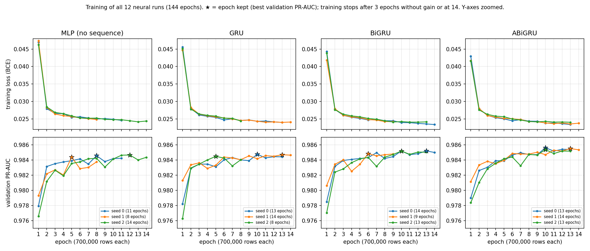

# Training report (evidence of training)

Generated by `v2/training_report.py` from the saved training records, checkpoints and logs. Every number below can be traced to a file in this repository.

## 1. What was trained

* **Neural models:** 4 architectures × 3 seeds = **12 training runs, 144 epochs in total**.
* **XGBoost:** 4 variants (all features, no static features, no pool features, cold/new-function), with seeds 1 and 2 also for the first two = 8 fitted models.
* **Data:** Huawei Cloud trace 2025, Region 5: 805,745 cold-start events, 31 days, 527 functions, cut into 5-minute buckets.
* **Training rows:** 2,110,176 (431 functions × days 7–23). **Validation:** 372,384 (days 24–26). **Test:** 496,512 (days 27–30), of which 443,520 are scored in the main results.

## 2. Neural training settings (identical for every run)

| Setting | Value |
|---|---|
| Loss | binary cross-entropy on logits |
| Optimizer | RMSprop, learning rate 0.001, alpha 0.9, eps 1e-8 |
| Batch size | 2,048 |
| One epoch | 700,000 training rows drawn at random from the 2,110,176 |
| Max epochs | 14 |
| Early stopping | stop after 3 epochs without validation PR-AUC gain; best epoch's weights restored |
| Learning-rate schedule | halve when validation PR-AUC stalls for 1 epoch |
| Gradient clipping | max norm 1.0 |
| Inputs | 57 standardized features + a 24-step × 7-channel history window (MLP: features only) |
| Device | Apple GPU (MPS) |
| Code | `v2/run_deep.py`, `v2/nets.py` |

## 3. Every neural training run

| Model | Seed | Epochs run | Best (kept) epoch | Why it stopped | Train loss: epoch 1 → last | Val PR-AUC: epoch 1 → best | Parameters | Training time | Log ✓ | Checkpoint ✓ |
|---|---|---|---|---|---|---|---|---|---|---|
| MLP (no sequence) | 0 | 11 | 8 | early stopping (3 epochs without gain) | 0.0469 → 0.0246 | 0.9779 → 0.9846 | 19,905 | 0 min 18 s | yes | yes |
| MLP (no sequence) | 1 | 8 | 5 | early stopping (3 epochs without gain) | 0.0474 → 0.0248 | 0.9793 → 0.9844 | 19,905 | 0 min 13 s | yes | yes |
| MLP (no sequence) | 2 | 14 | 12 | reached 14-epoch cap | 0.0463 → 0.0244 | 0.9766 → 0.9847 | 19,905 | 0 min 22 s | yes | yes |
| GRU | 0 | 13 | 10 | early stopping (3 epochs without gain) | 0.0456 → 0.0240 | 0.9782 → 0.9847 | 62,977 | 6 min 30 s | yes | yes |
| GRU | 1 | 14 | 13 | reached 14-epoch cap | 0.0447 → 0.0241 | 0.9813 → 0.9847 | 62,977 | 6 min 57 s | yes | yes |
| GRU | 2 | 8 | 5 | early stopping (3 epochs without gain) | 0.0451 → 0.0244 | 0.9763 → 0.9845 | 62,977 | 4 min 01 s | yes | yes |
| BiGRU | 0 | 14 | 13 | reached 14-epoch cap | 0.0443 → 0.0234 | 0.9785 → 0.9852 | 130,625 | 14 min 27 s | yes | yes |
| BiGRU | 1 | 9 | 6 | early stopping (3 epochs without gain) | 0.0418 → 0.0243 | 0.9806 → 0.9848 | 130,625 | 9 min 15 s | yes | yes |
| BiGRU | 2 | 13 | 10 | early stopping (3 epochs without gain) | 0.0439 → 0.0242 | 0.9770 → 0.9852 | 130,625 | 13 min 24 s | yes | yes |
| ABiGRU | 0 | 13 | 10 | early stopping (3 epochs without gain) | 0.0430 → 0.0234 | 0.9790 → 0.9856 | 142,977 | 15 min 01 s | yes | yes |
| ABiGRU | 1 | 14 | 13 | reached 14-epoch cap | 0.0417 → 0.0238 | 0.9811 → 0.9855 | 142,977 | 18 min 47 s | yes | yes |
| ABiGRU | 2 | 13 | 10 | early stopping (3 epochs without gain) | 0.0416 → 0.0241 | 0.9784 → 0.9854 | 142,977 | 14 min 58 s | yes | yes |

**Total: 144 epochs.** "Log ✓" = every epoch's loss and validation score in the training log matches the saved training record. "Checkpoint ✓" = the epoch history stored inside the saved model file matches it too. Training times are wall-clock seconds printed by the training script (several runs shared the machine with other jobs, so times vary).

Epoch-by-epoch numbers for every run are in `v2/results/info_<model>_s<seed>.json`; the figure below plots them.



## 4. XGBoost training

XGBoost has no epochs: it adds decision trees one at a time and stops when the validation score has not improved for 40 trees. Settings: max depth 8, learning rate 0.05, row and column sampling 0.8, min_child_weight 5, L2 1.0, up to 1,500 trees, evaluation metric PR-AUC.

| Variant | Features | Seed | Trees kept | Fit time |
|---|---|---|---|---|
| xgb_full | 57 | 42 | 356 | 36 s |
| xgb_full | 57 | 1 | 373 | not timed separately |
| xgb_full | 57 | 2 | 350 | not timed separately |
| xgb_no_static | 46 | 42 | 356 | 31 s |
| xgb_no_static | 46 | 1 | 412 | not timed separately |
| xgb_no_static | 46 | 2 | 336 | not timed separately |
| xgb_no_pool | 51 | 42 | 219 | 18 s |
| xgb_cold_newfunc | 10 | 42 | 110 | 10 s |

## 5. Saved model files and fingerprints

SHA-256 fingerprints identify each file exactly: if a file is changed, its fingerprint changes. Check one with `shasum -a 256 v2/models/<file>` (macOS/Linux).

| File | Size | SHA-256 |
|---|---|---|
| `abigru_s0.pt` | 0.58 MB | `08a33f2de9484e30c701199670643a038bf072dbf0167934880634fad0348e4f` |
| `abigru_s1.pt` | 0.58 MB | `cd6d95b4accced231cb3e024620785cd80897d24f006cce503f916416592400f` |
| `abigru_s2.pt` | 0.58 MB | `229b8409c3dcb2b56f3feb861082ab443091a4a8a56f167e4486d3e7840b017b` |
| `bigru_s0.pt` | 0.53 MB | `e9241fda9a09515fc60588da173c42b1636f8f376a38a84c6c7dcc6ee730ded7` |
| `bigru_s1.pt` | 0.53 MB | `48316972e01e20edab4419eebc33eed5b9967eb395ad374a1327aef862bfe16f` |
| `bigru_s2.pt` | 0.53 MB | `393cc843da10719755cf4f43cea06b10a8657b6a124bd5308cd9a3c93f426b28` |
| `gru_s0.pt` | 0.26 MB | `d8caadb16643a12b4cbe553df9d3859c8be61fe093df5ad7125e04ac12bd6018` |
| `gru_s1.pt` | 0.26 MB | `91f6cf711443898ddf8517a367de6f84bb957e8cd793a852370e2a1048b8ccab` |
| `gru_s2.pt` | 0.26 MB | `c953b9cc8e48c977bb579ca436d736d7b1b99a9842252b6337b7245b767ffae9` |
| `mlp_static_s0.pt` | 0.09 MB | `11c681b9ce397558af4dd8b45f47ae16ec3f6f6f01fd504597dbe816d5ba1db6` |
| `mlp_static_s1.pt` | 0.08 MB | `70ff3cc6c7093b88ca71055af2796df1dc628c176dd01f13427f13eca917e285` |
| `mlp_static_s2.pt` | 0.09 MB | `575d60d441f40810539e345e32bb85377f48bb6cf786206d53e45ba8b95a34f9` |
| `xgb_cold_newfunc_s42.json` | 3.66 MB | `391c97a9b05c27cdbd6cdabe415542d33421ccf9c81f387d65503acbabe6d52f` |
| `xgb_full_s1.json` | 5.56 MB | `3cb19c3c5cdf34dc2d4a69c9bbf27774c8650b41c6e375748b281d935998a749` |
| `xgb_full_s2.json` | 5.23 MB | `4075fde0effe40b578287dce7f66a3dd71cd3a737344a7e2e90e41ea60f6229e` |
| `xgb_full_s42.json` | 5.26 MB | `acf76041cb86ef0b255af51019674d3b8c5d5e0cddb23a80f1e1de046206c724` |
| `xgb_no_pool_s42.json` | 3.34 MB | `3f0fef235b5a48af00f13e0dd9ba7203d47b774f77a7790013d2fde4d772d767` |
| `xgb_no_static_features.json` | 0.00 MB | `0587bef42df1939ae5eb47ba489ef3362f0293128fdb689187dde5aa3a6b7cbb` |
| `xgb_no_static_s1.json` | 6.18 MB | `cbc19e4dff045b5c8872143bbd4b155fcb8a448adeb05764c1bf13c1ce479fab` |
| `xgb_no_static_s2.json` | 5.30 MB | `f90ba87a7b4344054545a44673422cdb8ecb5ed23dbee3a710ff0748209aaf08` |
| `xgb_no_static_s42.json` | 5.39 MB | `53e7a6851decc453c2ad219d313bd0fa0e5dda2e1363eec50613b8e4a8d8c251` |

## 6. Where the evidence is

| Evidence | Location |
|---|---|
| Per-epoch records (loss, validation PR-AUC) | `v2/results/info_<model>_s<seed>.json` |
| Console output printed during training | `v2/results/logs/` (local folder paths removed) |
| Trained models | `v2/models/` (`.pt` neural, `.json` XGBoost) |
| Training curves | `v2/figures/fig8_training_all_seeds.png` (all seeds), `fig6_training_curves.png` (seed 0) |
| Training code | `v2/run_deep.py`, `v2/nets.py`, `v2/run_gbdt.py`, `v2/run_xgb_seeds.py` |
| Test results produced by these models | `v2/results/benchmark.md`, `multiseed_summary.md`, `final_test_table.txt` |

Which log holds which run: `1_` and `2_` are the original runs; `3_` and `4_` are the same runs repeated with model saving switched on (they reproduced the original predictions exactly); `5_`–`7_` are XGBoost; `8_` is the robustness study.

## 7. How to demonstrate training live

```bash
COLDSTART_SMOKE=1 python3 v2/run_deep.py abigru 0   # 3 short epochs (~1 min); writes only to the system temp folder
python3 v2/predict.py --model abigru_s0 --function 0 --day 28   # load the real trained model and predict
```
The smoke run prints one line per epoch (training loss, validation PR-AUC, elapsed time), the same format as the logs above.